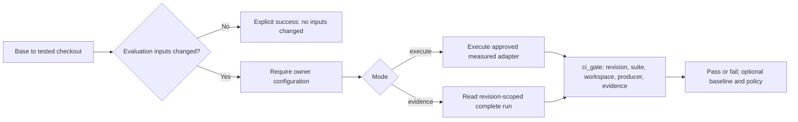

# Apastra CI Setup

CI is optional. Once enabled, relevant evaluation changes require complete evidence for the exact tested checkout. There is no default suite, production provider, or report-only success path.

## Install the workflow

Copy `templates/.github/workflows/regression-gate.yml` into the consuming repository's `.github/workflows/`. Install the Apastra runtime first; consumer workflows use `.agent/bin/apastra`, while this repository uses `bin/apastra`. Both need Python with `pyyaml` and `jsonschema`; the workflow installs these dependencies.

Configure the repository variables below, or supply the corresponding `workflow_call` inputs. Values are passed as quoted arguments, never evaluated as shell code.

| Repository variable | Reusable workflow input | Required value |
| --- | --- | --- |
| `APASTRA_CI_SUITE` | `suite` | Owner-selected suite ID |
| `APASTRA_CI_ADAPTER` | `adapter` | Checkout-relative approved measured adapter configuration |
| `APASTRA_CI_MODE` | `mode` | Explicit `execute` or `evidence` |
| `APASTRA_CI_RUN_DIRECTORY` | `run-directory` | Checkout-relative directory with `{revision}` as a path component, e.g. `ci-evidence/{revision}/candidate` |
| `APASTRA_CI_BASELINE` | `baseline` | Optional complete baseline run directory; requires policy |
| `APASTRA_CI_POLICY` | `policy` | Optional regression policy path; requires baseline |

A reusable caller outside a pull request must also supply `base`, a full base commit SHA. The tested revision is always `github.sha`, explicitly checked out and verified against Git `HEAD`. Pull requests normally test GitHub's merge commit, rather than the PR head commit.

Relevant inputs include prompts, flat and manifest-backed datasets, evaluators, suites, quick evals, policies, harnesses, runtime, schemas, validators, the CLI, and the regression gate workflow. Deletions count. Missing configuration or evidence fails relevant changes. Documentation-only changes can explicitly succeed without evaluation configuration.

## Evidence mode contract

The workflow does not fetch an artifacts branch, search for a global latest report, or pool old reports. A trusted producer must supply the complete run directory in the tested checkout before admission. It must include the request, invocation, evaluation, manifest, scorecard, cases, and any referenced evidence required by runtime admission. The run's source revision must equal the tested SHA, its suite must equal the configured suite, and its input digests must match the checked-out workspace. Directory names alone are not proof of freshness.

`{revision}` expands only to the tested full SHA. Paths must remain inside the checkout; absolute paths, traversal, and symlinks escaping the checkout fail. A pre-produced directory may instead contain the exact SHA as a literal path component. Revision-scoped retention/download is deliberately not implemented by this template. If a trusted producer cannot supply evidence for the exact merge SHA, use `execute` with an explicitly configured suitable adapter, or add a separately reviewed trusted producer integration. Do not commit fabricated passing evidence to enable the check.

## Execute mode contract

`execute` runs the configured suite through the approved measured adapter and admits the resulting complete run. The workflow provides no provider credentials and does not expose secrets to PR code. Choose an adapter that can run in the intended PR context. Do not select an example fixture or invent production configuration merely to make CI green.

This repository intentionally has no real model CI configuration. Relevant PRs therefore fail the gate until an owner configures a suitable suite, adapter, mode, and evidence location. Local deterministic fixtures test the enforcement contract; they do not demonstrate hosted provider execution. GitHub-hosted execution and owner-specific evidence production still require verification.

## Schema validation and required checks

The repository's `schema-validation.yml` uses existing Python validators for changed prompt specs/packages, flat or manifest-backed datasets, evaluators, suites, quick evals, regression policies, harness adapters, and baselines. Runtime, schema, or validator changes revalidate all matching assets. Flat JSONL datasets are validated directly; a retained manifest with missing cases fails. Markdown policy documents and executable harness source are not schema assets.

The stable workflow name is `Regression Gate` and its job is `gate`. After observing a hosted run, the owner should select its actual check name in branch protection. Installing files alone does not configure required checks or establish that hosted CI passed.

Other templates cover auto-merge, promotion, delivery, release, and approval records. Install and configure these separately when requested; they are not prerequisites for the gate.
